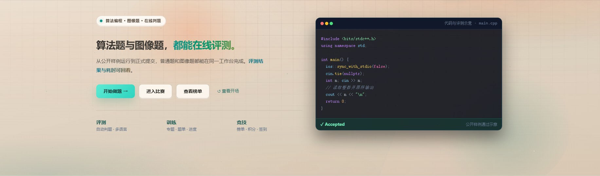
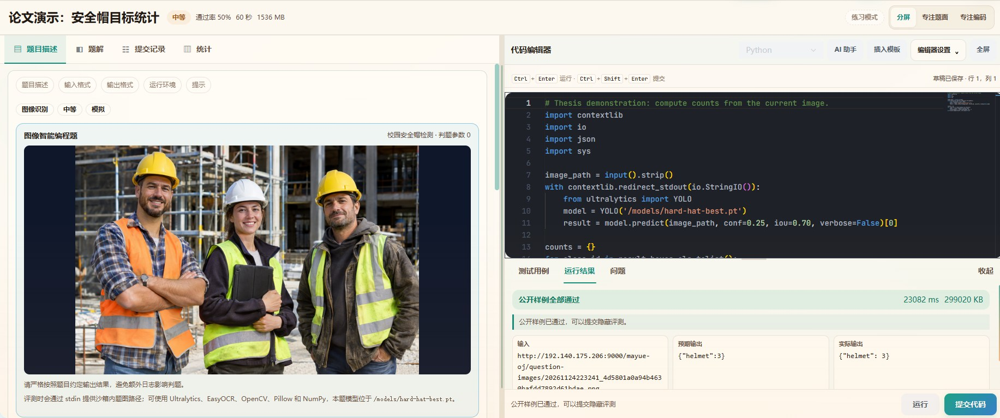
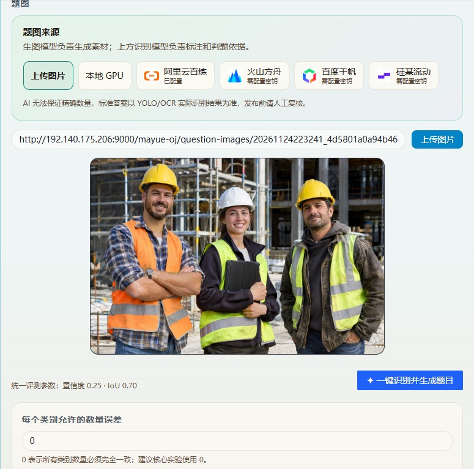
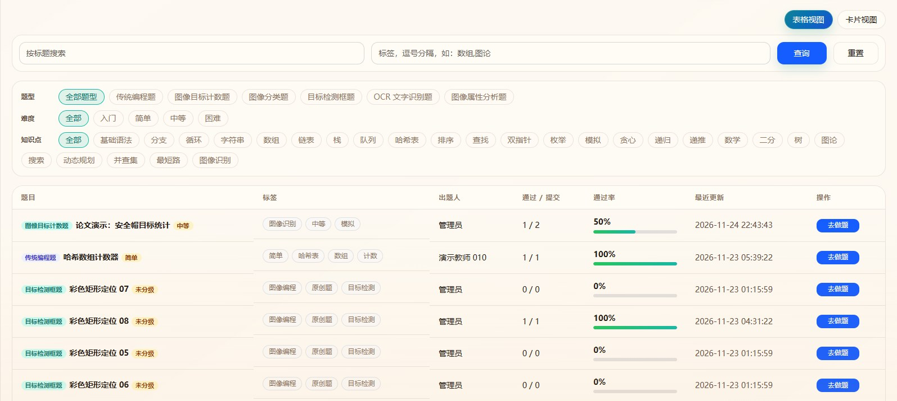
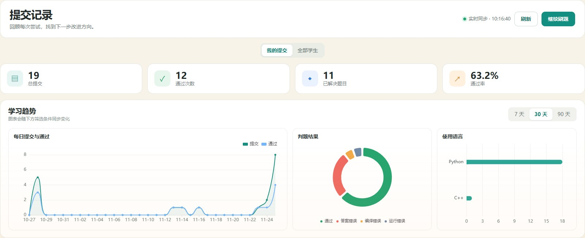
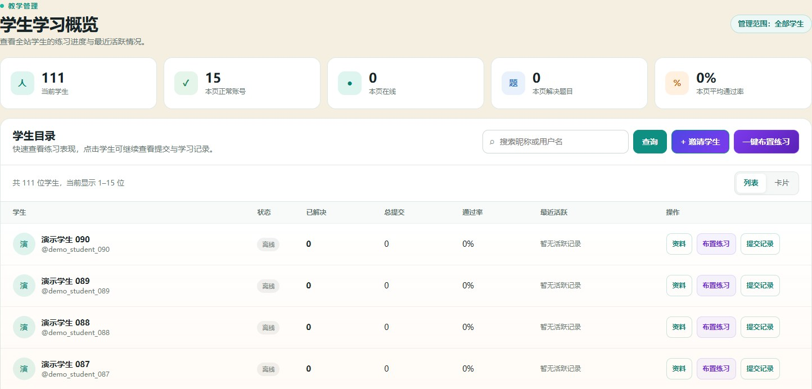
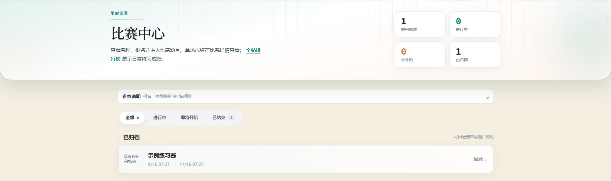
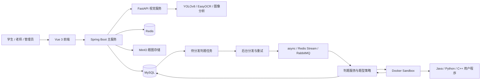

<div align="center">

# 码跃 OJ · MaYue OJ

**算法编程与图像编程，在同一个工作台完成。**

面向编程教学与计算机视觉实践的在线评测平台

[在线演示](http://192.140.175.206/) · [页面展示](#页面展示) · [核心功能](#核心功能) · [系统架构](#系统架构) · [运行部署](#运行与部署) · [项目文档](#文档)

`Vue 3` · `Spring Boot 3` · `Docker` · `YOLOv8` · `EasyOCR` · `OpenCV`

</div>

[](docs/images/showcase/01-home.jpg)

码跃 OJ 是毕业设计课题 **《融合图像识别的智能化在线编程判题系统设计与实现》** 的实现项目。除了题库、在线编码、竞赛和提交复盘，它还把图像识别任务组织成有公开样例、隐藏用例和明确输出协议的编程题，让学生通过代码处理图片，再由系统自动评测。

**核心场景：** 教师准备题图并复核候选答案，学生编写程序解决视觉任务，系统隔离执行代码并返回判定；老师可继续查看关联学生的学习与提交情况。

## 页面展示

以下图片均于 **2026-11-25** 从实际部署的网站截取，点击可查看原图。列表中标注“演示学生”的账号及“示例练习赛”用于功能展示，不代表真实用户规模或正式赛事。线上截图与当前源码的版本可能存在差异；截图不替代性能、权限及安全验收。

### 图像编程工作台

左侧查看公开题图，右侧编写 Python，通过运行结果核对输出。下图使用页面原有代码运行安全帽计数题，公开样例显示通过；这只验证了该次公开样例运行，不代表隐藏评测或全部题型都通过。

[](docs/images/showcase/03-image-judge.jpg)

### 智能辅助命题

<table>
<tr>
<td width="44%" valign="top">
<h4>从一张图片，到可评测的编程题</h4>
<p>选择通用目标检测或安全帽检测模型，上传题图，获取候选识别结果，再由命题人员复核。</p>
<p>题图生成与目标识别分开配置：生成图片用于准备素材，识别结果用于辅助形成参考答案，最终判题依据仍须人工确认。</p>
<p>支持图片上传、本地 GPU 与可配置的云端生图入口；外部服务需要单独部署或配置。</p>
<p><strong>截图只展示题图配置区域，未展示隐藏用例、隐藏答案或 API 密钥。</strong></p>
</td>
<td width="56%" valign="top">
<a href="docs/images/showcase/04-vision-authoring.jpg"></a>
</td>
</tr>
</table>

### 练习、复盘与教学管理

<table>
<tr>
<td width="50%" valign="top">
<a href="docs/images/showcase/02-problem-library.jpg"></a>
<p><strong>题库检索</strong> · 普通题与五类图像题统一浏览，按题型、难度和知识点缩小范围。</p>
</td>
<td width="50%" valign="top">
<a href="docs/images/showcase/05-submission-overview.jpg"></a>
<p><strong>提交复盘</strong> · 提交与通过趋势、结果分布和语言统计，支持个人及授权管理范围。</p>
</td>
</tr>
<tr>
<td width="50%" valign="top">
<a href="docs/images/showcase/06-student-management.jpg"></a>
<p><strong>教学管理</strong> · 查看学生学习概况，通过目录进入资料、练习和提交记录；图中账号为明确标注的演示账号。</p>
</td>
<td width="50%" valign="top">
<a href="docs/images/showcase/07-contests.jpg"></a>
<p><strong>比赛中心</strong> · 浏览赛程、参赛入口和已结束赛事；图中为已归档的示例练习赛。</p>
</td>
</tr>
</table>

截图来源、页面路径和更新注意事项见 [展示图说明](./docs/images/showcase/README.md)。

## 核心功能

| 模块 | 提供的能力 |
| --- | --- |
| 在线编程 | Monaco 代码编辑器；Python、Java、C++；运行公开样例、自定义输入与正式提交；时间、内存及错误反馈 |
| 图像编程题 | 一套题图传输与隔离执行流程，配套五类输出协议；公开图用于调试，隐藏图用于正式评测 |
| 辅助命题 | 题图上传、视觉识别、候选答案、人工复核与发布预检；可选 AI 题面整理与题图生成 |
| 提交与复盘 | 状态轮询、结果筛选、只读代码详情、ECharts 学习趋势与分布统计 |
| 教学工作台 | 学生、老师、管理员三角色；师生关系与数据范围；学生学习记录、题目管理和练习入口 |
| 竞赛与交流 | 比赛、榜单、题解、博客、评论和站内消息，支持训练后的复盘与分享 |
| AI 学习辅助 | 结合题目、代码和评测结果提供提示或诊断；支持个人模型配置，实际可用性取决于服务及 Key 配置 |

### 五类图像题，各有明确的判题规则

| 题型 | 学生输出 | 评测方式 |
| --- | --- | --- |
| **图像目标计数**（核心题型） | 类别到数量的 JSON，如 `{"helmet":3}` | 逐类别计数比较与数量容差 |
| 主目标标签分类 | 一个英文类别标签，如 `helmet` | 忽略大小写和首尾空白的标签匹配 |
| 目标位置检测 | 包含标签和归一化坐标的 JSON 数组 | 类别、框数量与 IoU 匹配 |
| OCR 文字识别 | 纯文本 | 文本规范化与编辑距离 |
| 图像数值分析 | 宽、高、模式、平均灰度、边缘强度等固定字段 | 字段校验及独立数值容差 |

主目标标签取自 **YOLO 检测结果中置信度最高的目标**，并非独立的整图分类模型。`OPENCV_ANALYSIS` 是图像分析策略标识，不是训练模型；具体属性由 Pillow、NumPy 或 OpenCV 按项目实现计算。

## 系统架构



浏览器只调用主服务。视觉服务用于辅助命题，代码沙箱用于运行学生程序；正式评分按命题人员确认的标准答案和规则进行，不交给大模型主观打分。更细的部署与模块划分见 [架构文档](./docs/ARCHITECTURE.md)。

### 关键工程设计

- **命题与评测分离：** 图片识别生成候选答案，人工复核后固定；正式提交重新运行学生程序，按题型策略比较结果。
- **受限代码执行：** Docker 环境设置网络隔离、非 root、只读文件与资源限制，题图由后端准备后传入；具体边界与部署要求见 [Sandbox 说明](./Sandbox/README.md)。
- **可靠提交链路：** 当前源码把提交记录、题目提交数原子自增、待分发任务写入同一数据库事务；后台投递失败后重试，消费端条件更新防重。提供至少一次投递，不宣称 MySQL 与外部 MQ 的强原子事务。
- **权限与数据范围：** 前端负责入口展示，后端根据账号角色、师生关系及资源归属限制访问。个人记录与管理范围分开，完整代码按授权返回。
- **可解释反馈：** 结果同时提供判定、耗时、内存和对应题型的失败原因；公开样例与隐藏评测分开处理。

可靠提交升级需要执行 [新增任务表 SQL](./spingboot-init/src/main/resources/db/migrations/V20261125__judge_task_outbox.sql)。源码中实现的改进不等于已更新到线上截图对应的部署版本。

## 技术与目录

| 部分 | 技术与职责 |
| --- | --- |
| `前端/myoj/` | Vue 3、TypeScript、Vite、Pinia、Monaco Editor、ECharts、Prism；练习、管理与交互界面 |
| `spingboot-init/` | Java 17、Spring Boot 3、MyBatis-Plus；身份权限、命题、提交、判题编排与统计 |
| `Sandbox/` | Spring Boot + Docker；隔离执行 Java、Python 和 C++ |
| `vision-ai/` | Python、FastAPI、YOLOv8、EasyOCR、Pillow、NumPy、OpenCV；候选识别与图像分析 |
| 基础服务 | MySQL、Redis、MinIO；数据、缓存与题图存储，RabbitMQ 为可选分发方式 |
| `deploy/ubuntu/`、`docs/` | Linux 部署示例、架构、实验记录和验收说明 |

## 验证与边界

功能截图展示产品流程，实验数据说明性能边界，两者分开记录。

| 项目 | 已有证据与限制 |
| --- | --- |
| 本次页面核验 | 实际访问线上页面；安全帽计数题的一次公开样例运行显示通过。未以此代替隐藏评测、全题型验收或并发测试 |
| 提交一致性改进 | 2026-11-25 本地后端回归 **152 项测试通过**并完成 JAR 打包；新增事务、并发和恢复测试使用隔离 H2，不代表真实 MySQL/MQ/沙箱联调完成 |
| 安全帽模型 | 独立测试集 883 张，mAP@0.5 为 **0.6763**，未达到任务书 0.80 目标；见 [原始评估](./docs/evidence/hard_hat_test.json) |
| OCR 与人工一致率 | 仓库尚无完整的独立人工对照证据，不能声称已达到任务书准确率指标 |
| 完整链路与并发 | 本仓库尚未归档覆盖所有题型的完整性能验收报告；不能把接口受理耗时视为判题完成耗时，也不能把虚拟用户数等同于真实活跃人数 |

任务书要求、评测方法和待验证事项见 [验收对照](./docs/TASKBOOK_ACCEPTANCE.md)。项目可用于毕业设计演示与工程实践交流；不把“功能多”作为企业级稳定性或量化指标达标的证明。

## 运行与部署

本地完整运行需要 JDK 17+、Maven、Node、Python、MySQL、Redis、MinIO 和 Docker，并准备视觉模型文件。**新建库使用总脚本，已有库升级使用对应迁移；上线前先备份、联调并保留回滚版本。**

- [数据库初始化与升级](./spingboot-init/src/main/resources/db/README.md)
- [Sandbox 使用与隔离执行](./Sandbox/README.md)
- [视觉服务配置与部署](./vision-ai/README.md)
- [Ubuntu 判题节点部署](./deploy/ubuntu/README.md)
- [源码交付清单](./DELIVERY_CHECKLIST.md)

毕业设计交付前可运行 `powershell -ExecutionPolicy Bypass -File .\tools\create-delivery-package.ps1`，生成排除私有配置、依赖缓存和构建产物的源码包。主服务目录 `spingboot-init` 保留历史拼写，未为展示调整包名。

<details>
<summary><strong>展开本地运行、模型准备与生产部署步骤</strong></summary>

## 本地运行

### 依赖

JDK 17+、Maven、Node 20.19+ / 22.12+、Python 3.11、MySQL 8+、Redis、MinIO、Docker（运行 Sandbox 时必需）。本地完整图像题还需要 YOLO / OCR 模型文件和足够内存。

### 步骤

1. 初始化库表：

```bash
mysql -u root -p -e "CREATE DATABASE IF NOT EXISTS test CHARACTER SET utf8mb4 COLLATE utf8mb4_unicode_ci"
mysql -u root -p test < spingboot-init/src/main/resources/db/schema.sql
```

总脚本只操作命令中指定的数据库；本地默认用 `test`，生产新库将命令中的 `test` 改为 `tan`。脚本包含表结构、开发用管理员 `admin` / `123456`、基础算法题和示例竞赛。已有库导入前先备份；公开部署前必须修改管理员密码。

2. 配置本机连接：参考 [.env.example](./.env.example) 设置操作系统或 IDE 环境变量；也可按 [`application-local.yml.example`](./spingboot-init/src/main/resources/application-local.yml.example) 在 `spingboot-init/` 模块根目录创建被 Git 忽略的 `application-local.yml`。选择 `dev` Profile 且工作目录为 `spingboot-init/` 时，`application-dev.yml` 会自动读取该文件；无需再填写 `--spring.config.additional-location`。Spring Boot 不会自动读取项目根目录的 `.env`；不要提交真实密码和密钥。`dev` 的 Redis 默认端口是 `16379`（供 FinalShell 隧道使用）；本机 Redis 运行在 `6379` 时需覆盖 `REDIS_PORT`。若使用远程 Sandbox，把其 URL 和相同的至少 32 位随机 `SANDBOX_AUTH_KEY` 写入本机私有配置；仓库默认地址是本机 `127.0.0.1:8080`。

3. 先准备 Python 镜像所需模型文件，再构建镜像并启动 Sandbox（需 Docker）：

```bash
docker build -t mayue-oj-python-vision:1.0 -f Sandbox/docker/python-vision/Dockerfile .
cd Sandbox && mvn spring-boot:run
```

构建前需要检查 `Sandbox/docker/python-vision/models/` 下的 `yolov8n.pt`、`hard-hat-best.pt` 和 `easyocr/` 下的两个模型文件。第三方通用权重和 OCR 权重不随 Git 仓库提供；缺少文件时 Docker 的 `COPY` 步骤会失败。Sandbox 还需要 `eclipse-temurin:17-jdk` 与 `gcc:13` 镜像，详见 [Sandbox 使用说明](./Sandbox/README.md)。

4. 在**另一个终端**启动主服务，显式选择 `dev` Profile，并设置与 SQL 脚本一致的数据库地址：

```powershell
cd spingboot-init
# PowerShell 示例；密码等敏感值通过系统或 IDE 环境变量设置
$env:SPRING_PROFILES_ACTIVE = 'dev'
$env:MYSQL_URL = 'jdbc:mysql://127.0.0.1:3306/test?useSSL=false&serverTimezone=Asia/Shanghai&allowPublicKeyRetrieval=true'
mvn spring-boot:run
```

5. 在**另一个终端**启动 YOLOv8 + EasyOCR 自动标注服务：

```powershell
cd vision-ai
python -m venv .venv
.venv\Scripts\Activate.ps1
pip install -r requirements.txt
python run.py
```

若需要“AI 生成题图 → 自动识别 → 自动出题”，Windows + NVIDIA 环境可直接在项目根目录运行：

```powershell
start-image-ai.bat
```

可直接双击 `start-image-ai.bat`。首次运行会自动安装 ComfyUI、NVIDIA PyTorch、YOLO/OCR 依赖并下载 Stable Diffusion 1.5 模型；后续会跳过已安装内容直接启动。新电脑需预先安装 Git、Python 3.12/3.13 和 NVIDIA 显卡驱动。脚本同时启动 `vision-ai:8090` 和 `ComfyUI:8188`，生成图片由后端转存到 MinIO，不依赖阿里云 OSS。

6. 在**另一个终端**启动前端：

```powershell
cd 前端/myoj && npm install && npm run dev
```

老师和管理员可以创建目标计数、主目标标签分类、检测框、OCR、图像数值分析五类图像编程题。选择题型并上传题图后，点击「一键识别并生成题目」，系统会生成待确认的题目内容与候选标准输出；发布前需人工复核标注和测试用例。

题目编辑页也可以选择「本地 GPU」或「百炼云端生图」。先选生图模型并生成一张预览图；确认后才会生成两张不同场景的隐藏图，逐张经过 YOLO/OCR 标注，再进行验题和人工复核。生图模型与上方的识别模型是两项独立设置。云端模式只使用当前教师在「账号设置 → AI 模型」保存的北京地域百炼 Key，可能按张计费；未配置 Key 时不会改用站点额度。本地可选模型必须同时出现在 ComfyUI 已安装列表及 `COMFYUI_ALLOWED_CHECKPOINTS`（英文逗号分隔）中。若百炼新模型在旧域名不可用，可由管理员在后端环境设置 `DASHSCOPE_IMAGE_BASE_URL` 为北京地域工作空间专属的 `.../compatible-mode/v1` 地址。已有数据库在主服务启动时自动增加题图来源和生图模型字段。

目标检测类题目可选择 `YOLO_GENERAL`（COCO 通用场景）或 `YOLO_HELMET`（本项目训练的校园安全帽模型，类别为 head / helmet / person）；OCR 与图像属性题分别自动路由到 EasyOCR 和 OpenCV。模型选择会随题目保存，并同步到识别服务、学生参考代码和隔离判题镜像。

### 个人大模型配置

已有 `tan` 数据库在主服务启动时会自动创建个人模型所需的两张缺失表，不清空现有数据；如果数据库账号没有建表权限，先备份数据库，再检查权限或执行 `spingboot-init/src/main/resources/db/schema.sql`。在主服务环境设置 `AI_CREDENTIAL_ENCRYPTION_KEY`：它必须是 **32 字节随机值的 Base64**，可用 `openssl rand -base64 32` 生成。妥善备份此值；更换或丢失后，已保存的个人 API Key 无法解密，需要用户重新填写。不要把密钥写入 Git 或截图。

启动后，用户进入「账号设置 → AI 模型」保存自己的百炼或 DeepSeek API Key、模型名并测试连接；做题助手和管理员传统题目 AI 录入页都可切换模型。未配置个人平台时，只有站点同时设置 `BAILIAN_ENABLED=true` 和有效 `DASHSCOPE_API_KEY`，才能使用站点默认百炼模型。用户保存的 API Key 仅在服务端解密、调用对应平台；浏览器只保存非敏感的模型选择。`ai_usage_log` 只记录平台、模型、功能、耗时和是否成功，不记录密钥、题目代码或对话内容。YOLO、OCR、ComfyUI 与程序判题不使用这里的大模型配置。

- 页面：http://localhost:5173  
- 接口文档：http://localhost:8888/api/doc.html  

### 生产部署概览

已有库升级当前可靠提交链路时，先备份并停止旧后端，执行 [判题任务迁移](./spingboot-init/src/main/resources/db/migrations/V20261125__judge_task_outbox.sql)，再部署新版 JAR。不要只替换 JAR 而遗漏新增任务表；新建库使用完整 `schema.sql`。

- 前端运行 `npm run build` 后由 Nginx 提供静态页面；`/api/` 转发到仅供本机访问的主服务，参考 [Nginx 示例](./前端/myoj/deploy/nginx.example.conf)。
- 主服务使用 `prod` Profile；JAR 内的 `application-prod.yml` 只有环境变量占位，不含真实密码。MySQL、Redis、MinIO、Sandbox 和 `vision-ai` 的地址及密钥由服务器环境变量提供。不要把真实配置打进 JAR 或提交 Git。
- Sandbox 在 Linux + Docker 上运行，`vision-ai` 可复用已构建的 Python 视觉镜像；二者的端口不对公网开放。见 [Ubuntu 部署说明](./deploy/ubuntu/README.md)与 [视觉服务部署说明](./vision-ai/README.md)。
- 本地 ComfyUI、百炼生图和做题助手都是可选功能，按实际部署情况启用；未部署时不要在演示中声称可用。

---

</details>

## 文档

| 文件 | 说明 |
|------|------|
| [docs/ARCHITECTURE.md](./docs/ARCHITECTURE.md) | 架构与接口模块 |
| [docs/VISION_JUDGE_DESIGN.md](./docs/VISION_JUDGE_DESIGN.md) | 图像出题、模型路由与智能判题闭环 |
| [docs/GRADUATION_THESIS_GUIDE.md](./docs/GRADUATION_THESIS_GUIDE.md) | 毕业论文结构、实验指标与答辩演示建议 |
| [docs/TASKBOOK_ACCEPTANCE.md](./docs/TASKBOOK_ACCEPTANCE.md) | 任务书指标、真实测试结果与待完成验收 |
| [spingboot-init/src/main/resources/db/README.md](./spingboot-init/src/main/resources/db/README.md) | 数据库脚本 |
| [Sandbox/README.md](./Sandbox/README.md) | 判题机部署 |
| [vision-ai/README.md](./vision-ai/README.md) | YOLO / OCR 服务的运行和部署 |
| [deploy/ubuntu/README.md](./deploy/ubuntu/README.md) | Ubuntu 判题节点部署与验收 |
| [DELIVERY_CHECKLIST.md](./DELIVERY_CHECKLIST.md) | 源码提交、恢复和验收清单 |

---

## 安全与开源

**公开前检查**

- `application-dev.yml` 和 `application-prod.yml` 只保存环境变量占位或非敏感默认值。真实密码、令牌和个人模型加密密钥必须放在本地私有文件、宝塔项目环境变量或服务器 `/etc/mayue-oj/app.env` 中；更新 JAR 不会覆盖服务器环境变量。
- `.env`、模块根目录的 `application-local.yml`、`*.private-backup.yml`、虚拟环境、运行日志和构建产物应留在本机；首次克隆后参考 [.env.example](./.env.example) 和 `application-local.yml.example` 自行配置。提交前仍需扫描 Git 状态和历史。
- 本地的 `vision-ai.tar`、第三方模型权重和 OCR 权重可能很大，已在 `.gitignore` 排除；提交前仍应检查 `git status` 与文件大小。当前 Dockerfile 需要部分不随仓库提供的模型文件，按上文准备后才能构建。

**若曾提交过含密钥的旧配置**

- 在 MinIO、百炼、邮箱、JWT 等服务中**轮换已暴露的密钥**后再公开仓库；仅修改当前文件无法清除 Git 历史中的泄露。

**许可**

- 本仓库源码按 [MIT](./LICENSE) 许可提供；第三方模型、数据集及其权重的许可另行遵守原权利人的条款。
- 源码包不分发任何第三方音乐或歌词。音乐播放器组件仅作为前端功能实现保留；如需演示，应使用本人原创或具有明确再分发许可的音频，并另行标注作者与许可证。
